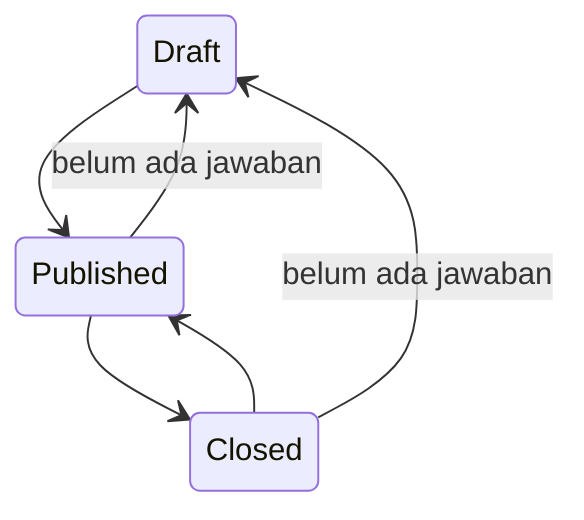
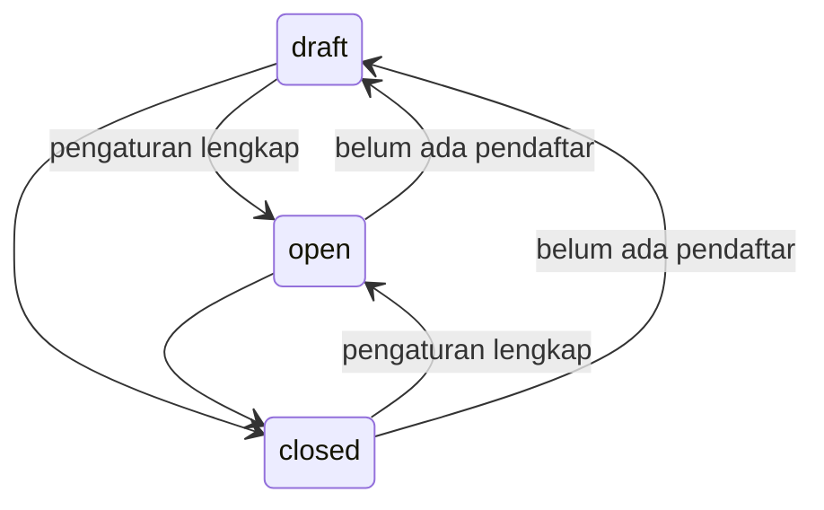
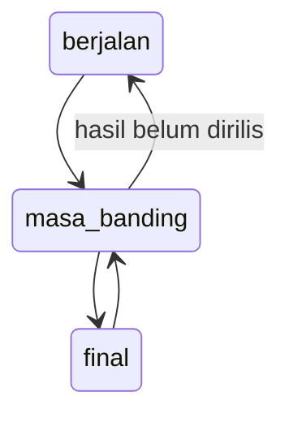
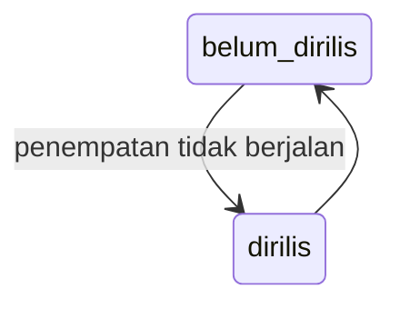
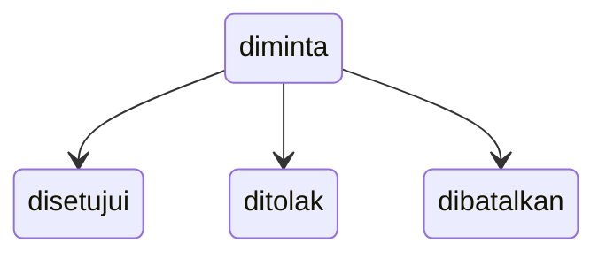
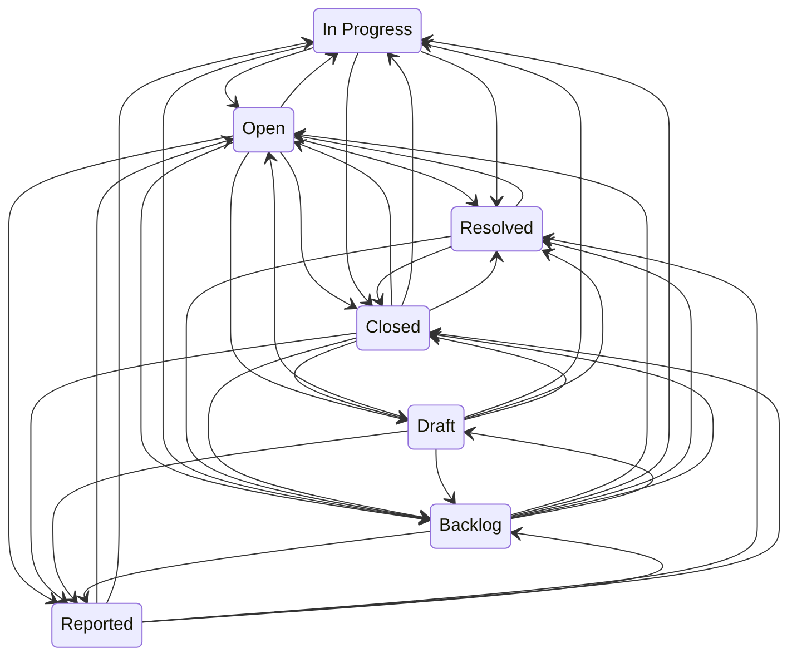

# Siklus hidup status

<!-- Di-generate oleh `bun run docs:lifecycle` dari `src/lib/lifecycle`. Jangan disunting manual. -->

Perpindahan status yang sah. Yang tidak tergambar ditolak server. Label
pada panah adalah syarat yang diperiksa sebelum pindah; ditulis lewat
`transition()` atau diperiksa lewat `assertMove()` di `src/server/api/lifecycle.ts`.

## form

Keadaan: `Draft`, `Published`, `Closed`.

## oprec

Keadaan: `draft`, `open`, `closed`.

## penempatan

Keadaan: `berjalan`, `masa_banding`, `final`.

## rilis hasil

Keadaan: `belum_dirilis`, `dirilis`.

## permintaan pindah

Keadaan: `diminta`, `disetujui`, `ditolak`, `dibatalkan`.

## laporan

Keadaan: `Open`, `In Progress`, `Resolved`, `Closed`, `Draft`, `Backlog`, `Reported`.

